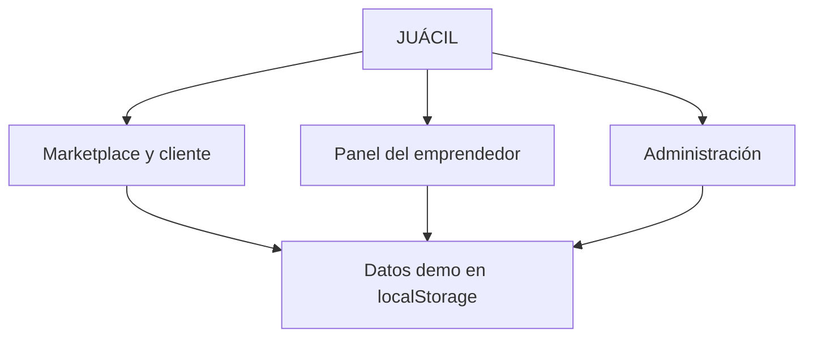
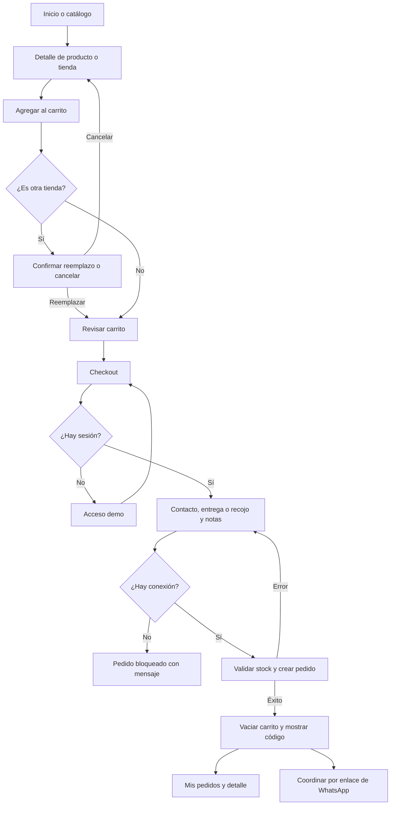
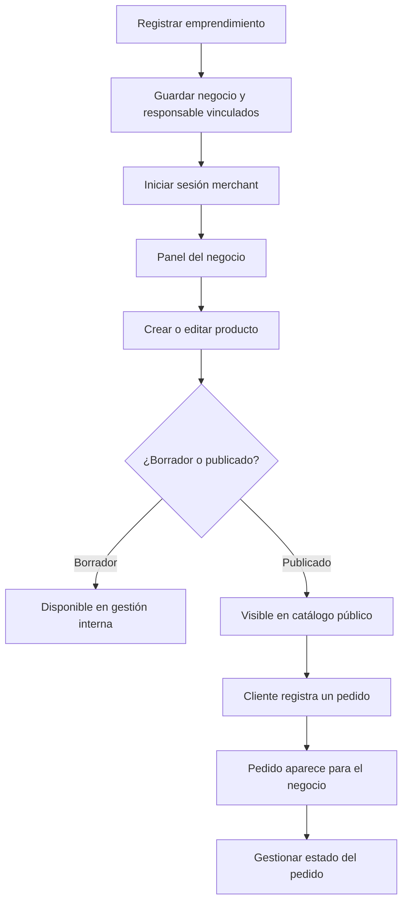
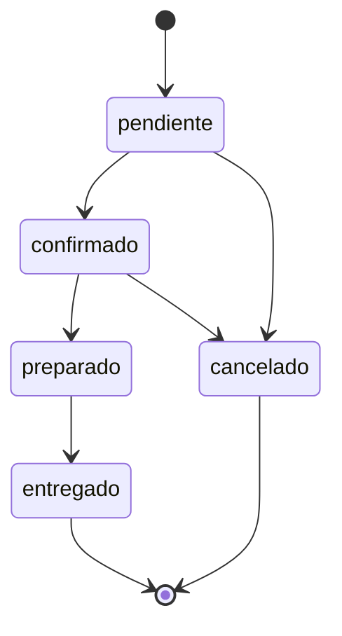
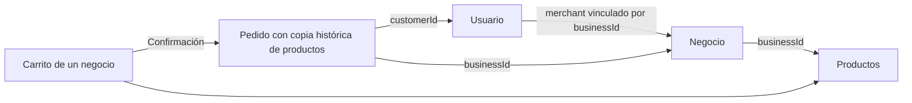

# JUÁCIL: mapa de módulos y flujos actuales

Mapa basado en la lectura del código del prototipo el 14 de octubre de 2026. Describe lo implementado, contrastado con la intención de los documentos de `docs`; no constituye una prueba de ejecución ni certifica que todos los recorridos funcionen sin errores.

## 1. Cómo se organiza el sistema

JUÁCIL tiene tres áreas de navegación y una base de datos demo compartida en el navegador:

No hay un servidor que conecte a compradores y vendedores en dispositivos distintos. Al cambiar de perfil demo en el mismo navegador, se consulta el mismo conjunto de usuarios, negocios, productos y pedidos.

## 2. Módulos funcionales

| Área / módulo | Qué permite | Rutas actuales | Código principal |
| --- | --- | --- | --- |
| Inicio | Presentar el marketplace y dar entrada a productos, catálogo y registro | `/` | `src/pages/home` |
| Catálogo | Buscar por nombre, descripción y características; filtrar por categoría y ubicación; ordenar por precio, nombre o fecha | `/catalogo` | `src/pages/catalog` |
| Producto | Consultar ficha y disponibilidad, elegir cantidad y agregar al carrito | `/productos/:id` | `src/pages/product-detail` |
| Tienda pública | Consultar un negocio y sus productos; acceder a coordinación de contacto | `/tiendas/:id` | `src/pages/store-detail` |
| Acceso demo | Seleccionar o identificar un perfil y entrar según rol | `/acceso` | `src/pages/auth/LoginPage.tsx` |
| Registro de cliente | Crear usuario cliente local e iniciar su sesión | `/registro/cliente` | `src/pages/auth/RegisterCustomerPage.tsx` |
| Registro de negocio | Crear negocio y usuario emprendedor vinculado; entrar al panel | `/registro/emprendimiento` | `src/pages/auth/RegisterBusinessPage.tsx` |
| Recuperación de acceso | Mostrar respuesta simulada a un correo ingresado | `/recuperar-acceso` | `src/pages/auth/RecoverPasswordPage.tsx` |
| Carrito | Agregar, quitar y cambiar cantidades; mostrar resumen en página o drawer; confirmar cambio de tienda | `/carrito`, drawer global | `src/pages/cart`, `src/features/cart`, `CartProvider.tsx` |
| Checkout | Recoger contacto, entrega/recojo y notas; crear pedido local y mostrar confirmación | `/pedido/confirmar` | `src/pages/checkout` |
| Pedidos del cliente | Consultar pedidos propios y detalle; cancelar cuando corresponde | `/mis-pedidos`, `/mis-pedidos/:id` | `src/pages/customer-orders` |
| Perfil | Editar datos personales y consultar resumen de pedidos del usuario | `/perfil`, `/mi-cuenta` | `src/pages/customer-account` |
| Panel del emprendedor | Reportes, pedidos, productos y perfil del negocio mediante pestañas; formularios en modales | `/panel` | `src/pages/merchant-dashboard` |
| Perfil del negocio | Editar información comercial en una página dedicada | `/panel/negocio` | `src/pages/merchant-business` |
| Gestión de productos | Listar, crear y editar productos propios | `/panel/productos`, `/panel/productos/nuevo`, `/panel/productos/:id/editar` | `src/pages/merchant-products`, `src/features/product-management/ProductForm.tsx` |
| Gestión de pedidos | Consultar pedidos del negocio y cambiar su estado | `/panel/pedidos`, `/panel/pedidos/:id` | `src/pages/merchant-orders` |
| Notificaciones | La ruta actual reutiliza el dashboard del emprendedor; no es una página independiente | `/panel/notificaciones` | `AppRouter.tsx`, `MerchantDashboardPage.tsx` |
| Administración | Gestionar tiendas y usuarios, consultar pedidos y cambiar estados de cuentas/negocios | `/admin`, `/admin/usuarios`, `/admin/tiendas` | `src/pages/admin/AdminDashboardPage.tsx` |
| Ayuda y evaluación | Preguntas frecuentes y cuestionario de 10 preguntas | `/ayuda` | `src/pages/help/HelpPage.tsx` |
| Errores | Informar acceso denegado o ruta desconocida | `/403`, cualquier ruta no encontrada | `src/pages/errors` |

Los filtros actuales del catálogo se guardan en los parámetros `q`, `categoria`, `ubicacion` y `orden` de la URL. Ordenar por precio está implementado; no se observó un filtro por rango de precio en esa página.

## 3. Flujo del comprador

Agregar al carrito no reserva inventario: el descuento de stock ocurre al crear el pedido. En ese momento el repositorio utiliza el precio vigente del producto y guarda una copia histórica de nombre, imagen, precio y subtotal dentro del pedido.

La coordinación por WhatsApp prepara un enlace; no envía mensajes automáticamente. El prototipo no procesa pagos reales.

## 4. Flujo del emprendedor

El registro genera dos entidades: un negocio y un usuario con rol `merchant` cuyo `businessId` apunta a ese negocio. Guarda `onboardingStep: 2` y navega al panel. El catálogo público obtiene productos publicados; la gestión del emprendedor consulta los productos asociados a su negocio.

Actualmente hay dos superficies de gestión: las pestañas/modales del dashboard y las páginas dedicadas de productos, pedidos y negocio. Representan funciones relacionadas sobre los mismos datos, no sistemas distintos.

## 5. Ciclo de un pedido

- Al crear: se comprueba disponibilidad, se descuenta stock, se genera código `JUA-…` y se guarda el pedido como `pendiente`.
- Al cambiar estado: se valida la transición y se agrega una entrada al historial con fecha y nota.
- Al cancelar: se devuelve stock y se registra una marca para impedir devolverlo nuevamente.
- `preparado` solo puede pasar a `entregado`; entregados y cancelados no admiten nuevas transiciones en la máquina de estados.

Referencias: `src/shared/lib/storage.ts` y `src/entities/order/model/orderStateMachine.ts`.

## 6. Flujo de administración

El usuario `admin` entra a `/admin`. La página concentra pestañas de tiendas, usuarios y pedidos. Sus acciones leen y modifican el mismo repositorio local que usan el marketplace y el panel del negocio.

Las rutas `/admin`, `/admin/usuarios` y `/admin/tiendas` renderizan el mismo componente. Este inicia su pestaña local en `tiendas`; no se observó selección de pestaña basada en la ruta dentro de la página. Por tanto, una ruta distinta no representa necesariamente una pantalla o pestaña distinta.

El guard del panel permite también al administrador entrar a `/panel`; el dashboard usa un negocio de respaldo si no tiene `businessId`. Algunas páginas dedicadas del emprendedor comprueban además `isMerchant` y `businessId`, por lo que esa entrada administrativa no implica acceso uniforme a todo el panel.

## 7. Datos y servicios compartidos

| Pieza | Responsabilidad | Persistencia |
| --- | --- | --- |
| `LocalStoreRepository` | Usuarios, negocios, productos, pedidos, stock y cambios de estado | `localStorage`: `juacil_app_store_v2.4` |
| `SessionProvider` | Usuario activo, rol, negocio asociado, entrada y salida | ID activo: `juacil_active_user_id_v1.0` |
| `CartProvider` | Artículos, cantidades, total, reemplazo y apertura del drawer | Carrito: `juacil_cart_store_v1.0` |
| `ConnectivityProvider` | Conectividad del navegador y switch de offline simulado | Estado de React; simulación no persistida |
| Helpers de dinero, fechas e IDs | Formato y generación de valores comunes | Sin almacén propio |
| Componentes de `shared/ui` | Botones, campos, modales, tarjetas y avisos | Sin almacén propio |

En ausencia de datos, el repositorio carga fixtures `mockUsers`, `mockBusinesses`, `mockProducts` y `mockOrders`. Tiene recuperación básica ante datos incompatibles y operaciones de reset. La sesión arranca con el cliente demo `user-client-01` si no encuentra un usuario activo válido. El carrito está separado de la sesión: no existe una clave de carrito por usuario en su proveedor.

## 8. Cómo leer las carpetas

| Carpeta | Papel | Ejemplo |
| --- | --- | --- |
| `src/app` | Composición, rutas, layouts, contextos y estilos generales | AppRouter, SessionProvider, MerchantLayout |
| `src/pages` | Pantallas y recorridos completos | CatalogPage, CheckoutPage |
| `src/widgets` | Bloques de navegación y estructura | Navbar, MobileBottomNav, Footer |
| `src/features` | Interacciones reutilizables | ProductForm, CartDrawer, ReplaceCartModal |
| `src/entities` | Conceptos de negocio, fixtures y reglas | User, Business, Product, Order, Cart |
| `src/shared` | UI, configuración y utilidades compartidas | Button, ROUTES, formatMoney, LocalStoreRepository |

El código actual ubica la persistencia con lógica de negocio en `shared/lib/storage.ts`; los contratos por dominio e inyección propuestos en documentos no deben confundirse con una separación ya implementada.

## 9. Diferencias que conviene conocer antes de rediseñar

- La documentación inicial no incluía administrador; el router y los modelos actuales sí lo incluyen.
- Checkout, historial y perfil están registrados sin `ProtectedRoute` en el router público: sus páginas hacen comprobaciones propias. Checkout comprueba que exista sesión, pero no exige explícitamente rol `cliente`; la intención documentada es más restrictiva.
- El acceso es demo: la contraseña del formulario no se valida como credencial real. Se seleccionan usuarios locales por correo/teléfono o por palabras clave de demostración.
- Cerrar sesión deja al usuario sin sesión durante la ejecución actual; al recargar, el inicializador puede volver al cliente demo por defecto.
- La encuesta de ayuda maneja respuestas y confirmación en estado React: no se observó almacenamiento ni consolidación de resultados. No equivale a un piloto realizado ni a un servicio de encuestas.
- La simulación offline bloquea checkout, pero no demuestra instalación PWA, arranque sin red ni sincronización entre dispositivos.
- Las comprobaciones de rol y propiedad están repartidas entre guards y páginas; no representan autorización de servidor.

Estas observaciones sirven para entender el estado actual y decidir futuras mejoras. Este mapeo no modifica la aplicación.
